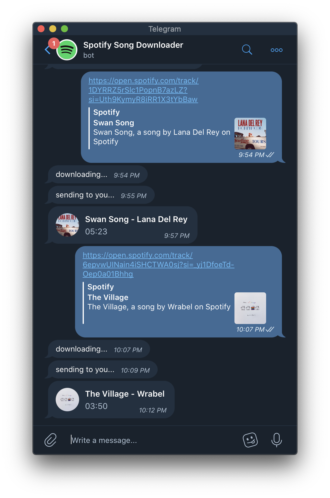

# TelegramSpotifyDownloader

<p align="center">
  <a href="https://www.python.org">
    
  </a>
  <a href="https://heroku.com/deploy?template=https://github.com/gsoosk/TelegramSpotifyDownloader/tree/heroku">
    
  </a>
  <a href="https://t.me/spotdl_tel_bot">
    
  </a>
  <br>
  <a href="https://github.com/gsoosk/TelegramSpotifyDownloader/stargazers">
    
  </a>
  <a href="https://github.com/gsoosk/TelegramSpotifyDownloader/fork">
    
  </a>  
</p>

## What is it?
This is a simple bot to download songs from YouTube in an MP3 format by using Spotify's HTTP link.

You can download: 
* A single song
* Albums
* Playlists
* Artists

It shows a **live progress bar** while downloading and sends every track back with proper title/artist metadata.




## How to run?

1. Add your bot token to a `.env` file with the `TELEGRAM_TOKEN` key:
   ```
   TELEGRAM_TOKEN=123456:your-telegram-bot-token
   ```

2. Install the requirements (Python 3.10+):
   ```
   pip install -r requirements.txt
   ```

3. Install **ffmpeg** (required by spotdl). Either system-wide:
   ```
   sudo apt install ffmpeg        # Debian/Ubuntu
   brew install ffmpeg            # macOS
   ```
   or let spotdl install it locally:
   ```
   spotdl --download-ffmpeg
   ```

4. Run the bot:
   ```
   python main.py
   ```

Then send any Spotify link (track, album, playlist or artist) to your bot.

## Authentication
The bot supports optional password protection. In `config.json` set:

```json
{
  "AUTH": {
    "ENABLE": true,
    "PASSWORD": "your-secret",
    "OWNER_ID": null,
    "USERS": []
  }
}
```

When enabled, new users must send the password once to sign in. The first user to
sign in becomes the `OWNER_ID`. Signed-in users are persisted in `config.json`, and
anyone can sign out with `/logout`.

Commands:
* `/start` – welcome / sign in
* `/help` – usage help
* `/logout` – sign out

## Downloader
This bot uses [spotDL v4](https://github.com/spotDL/spotify-downloader) — the modern,
stable rewrite — to find tracks on YouTube and download them with album art, lyrics and
metadata. (The old note about spotdl v3 being unreliable no longer applies; v4 is solid.)

## Docker 
Build and run:
```
docker build -t spotify-downloader .
docker run --rm --env-file .env spotify-downloader
```

## Deploy manually on Heroku
To deploy on heroku:

1. Change `config.json` if you want and commit it
2. Put your bot token to a `.env` file with `TELEGRAM_TOKEN` key
3. Run `./heroku_deploy.sh`

## TODO
- [x] Update Dockerfile
- [x] Update to python-telegram-bot v22 (async)
- [x] Update to spotdl v4
- [x] Add Progress Bar
